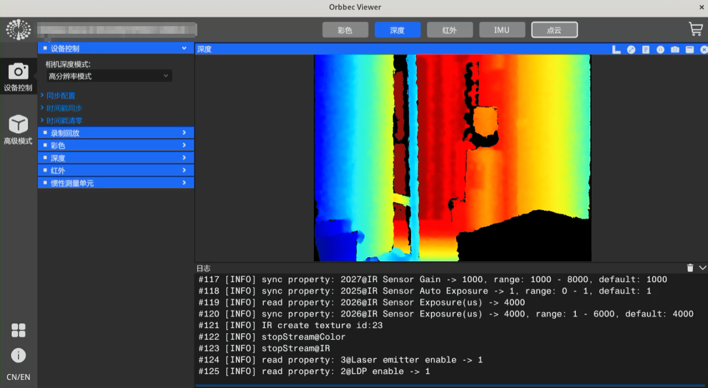

# 01 下载安装与准备（Ubuntu）

> **位置**：奥比中光深度相机通用上手 WIKI · Ubuntu 平台
>
> **前置**：[通用 / 01 产品准备](../通用/01_产品准备.md)
>
> **相关**：[Windows · 01 下载安装与准备](../Windows平台/01_下载安装与准备.md)
>
> **本步目标**：安装 Orbbec SDK（含 OrbbecViewer）→ 配置 udev 规则 → 能枚举到设备

## 0. 结论

> ✅ 从 [Releases 页](https://github.com/orbbec/OrbbecSDK_v2/releases) 下载**一体安装包**（`.deb`）：
>
> - x86_64 主机：**`OrbbecSDK_<版本>_amd64.deb`**
> - ARM64 主机：**`OrbbecSDK_<版本>_arm64.deb`**
>
> ✅ 安装：`sudo dpkg -i <deb 文件>`
>
> ✅ udev 规则由 **`.deb` 安装过程自动配置**（安装输出中会显示规则文件路径），见第 4 节

一体安装包同时包含 **Orbbec SDK** 与 **OrbbecViewer**，安装一次即可满足两种用途：

| 用途          | 使用工具                            | 本文步骤                                   |
| ----------- | ------------------------------- | -------------------------------------- |
| 查看图像、验证设备状态 | **OrbbecViewer**（图形界面）          | 第 3 节安装 → 第 4 节配置 → 第 5 节              |
| 编写程序读取数据流   | **Orbbec SDK v2**（C/C++/Python） | 第 3、4 节 → [02 SDK 示例上手](02_SDK示例上手.md) |

## 1. 系统要求

| 项目   | 要求                                                                                                                                                                                                               |
| ---- | ---------------------------------------------------------------------------------------------------------------------------------------------------------------------------------------------------------------- |
| 操作系统 | Ubuntu 18.04 及以上。官方对 x64 已验证 **Ubuntu 20.04 / 22.04 / 24.04**                                                                                                                                                    |
| 架构   | **x86_64（amd64）或 ARM64（arm64），由主机决定，与相机型号无关**。ARM64 方面，官方点名支持的平台为 NVIDIA Jetson 系列（AGX Orin / Orin NX / Orin Nano / AGX Xavier / Xavier NX，系统基于 JetPack）；**其他 ARM64 平台在架构上同样可安装 `arm64` 包，但不在官方支持列表内，支持程度需自行验证** |
| 接口   | USB 3.0 口（推荐；USB 2.0 可运行，但高分辨率 / 高帧率受限）                                                                                                                                                                          |
| 硬件   | 内存 8GB 及以上；建议四核 2.9GHz 及以上                                                                                                                                                                                       |

> 编译 SDK 示例需另行安装 GCC（≥ 7.5）、CMake（≥ 3.15）与 OpenCV（可选），见 [02 SDK 示例上手](02_SDK示例上手.md) 第 2 节。
>
> ⚠️ **架构与 SDK 世代是两个不同的维度**，不要混淆：**架构**（amd64 / arm64）由**主机**决定，决定下载哪个安装包；**SDK 世代**（v1 / v2）由**相机型号与固件**决定，决定使用哪套 SDK。后者请先按 [通用 / 01 产品准备](../通用/01_产品准备.md) 第 6 节确认，本文针对 **SDK v2**。

## 2. 下载

### 2.1 下载位置

| 位置                   | 地址                                                                                                                    |
| -------------------- | --------------------------------------------------------------------------------------------------------------------- |
| ✅ **主入口**            | [Orbbec SDK v2 Releases](https://github.com/orbbec/OrbbecSDK_v2/releases)                                             |
| 仅当第 1 节的世代判断结果为 v1 时 | [Orbbec SDK v1 仓库](https://github.com/orbbec/OrbbecSDK)（国内可访问镜像：[Gitee](https://gitee.com/orbbecdeveloper/OrbbecSDK)） |

### 2.2 选择下载文件

Releases 页的 Assets 中提供多类安装包。Linux 平台会出现以下文件，按下表识别并按主机架构选择：

| 文件名                                                   | 说明                                                | 是否适用        |
| ----------------------------------------------------- | ------------------------------------------------- | ----------- |
| ✅ `OrbbecSDK_<版本>_amd64.deb`                          | **一体安装包**（SDK + OrbbecViewer），x86_64              | x86_64 主机使用 |
| ✅ `OrbbecSDK_<版本>_arm64.deb`                          | **一体安装包**（SDK + OrbbecViewer），ARM64               | ARM64 主机使用  |
| `OrbbecSDK_<版本>_<日期>_<commit>_linux_x86_64.tar.gz`    | **SDK 压缩包**，解压即用；示例需用自带的 `build_examples.sh` 自行编译 | 不使用一体安装包时   |
| `OrbbecSDK_<版本>_<日期>_<commit>_linux_arm64.tar.gz`     | 同上（ARM64）                                         | 同上          |
| `OrbbecViewer_<版本>_<日期>_<commit>_linux_x86_64.tar.gz` | **独立查看器**，解压即用                                    | 不需要（一体包已含）  |
| `OrbbecViewer_<版本>_<日期>_<commit>_linux_arm64.tar.gz`  | **独立查看器**（ARM64）                                  | 不需要（一体包已含）  |

✅ **本步骤使用一体安装包**，按主机架构选 `amd64` 或 `arm64` 版本。

> 下载前需先点击 Assets 区域的 `Show all xx assets` 展开全部文件，避免遗漏。
>
> 文件识别方式：**前缀**（`OrbbecSDK` / `OrbbecViewer`）加**平台与架构后缀**（`amd64.deb` / `arm64.deb` / `linux_x86_64` / `linux_arm64`）。文件名中的版本号、日期与 commit 号随版本变化，不影响识别；`win*`、`macOS` 等为非 Linux 平台文件，可忽略。
>
> **压缩包方式的官方步骤**（不使用一体安装包时参考）：解压 → 进入 `shared/` 目录安装 udev 规则脚本 → 运行 `build_examples.sh` 编译示例 → 进入 `bin/` 运行 `ob_quick_start`。

## 3. 安装

以主机架构对应的 `.deb` 文件执行安装：

```bash
sudo dpkg -i OrbbecSDK_<版本>_amd64.deb        # ARM64 主机改为 _arm64.deb
```

安装完成后，可列出该包释放的全部文件路径：

```bash
dpkg -L orbbecsdk
```

> **安装后文件位于 `/opt/OrbbecSDK_<版本>/` 目录下**，用 `dpkg -L orbbecsdk` 可列出该包释放的全部路径。官方文档另述「头文件与库文件安装到 `/usr/local`」—— **实际布局以 `dpkg -L orbbecsdk` 的输出为准**。
>
> 若安装过程中提示依赖缺失，可先执行 `sudo apt-get install -f` 补全依赖，再重新安装。
>
> ⚠️ 若 `dpkg -i` 报错「内部 gzip 读取错误」「buffer error」或「未预期的文件结束或流结束」，说明**安装包未下载完整**（属文件损坏，而非依赖问题）。请重新下载安装包，并**先核对文件大小与校验和**再执行安装 —— Releases 页的 Assets 中会显示各文件大小，SHA256 可通过 GitHub API 获取。

**后续步骤需要定位的文件，可用 `dpkg -L orbbecsdk` 配合 `grep` 查找**，例如：

```bash
dpkg -L orbbecsdk | grep -i udev      # udev 规则脚本（第 4 节）
dpkg -L orbbecsdk | grep -i viewer    # OrbbecViewer 相关条目（第 5 节）
```

> `grep -i viewer` 的结果中除可执行文件外，还包含同名的许可文件目录，实际可执行文件可用 `file <路径>` 确认（显示为 ELF 可执行文件的那个）。

## 4. udev 规则（决定设备能否被普通用户访问）

**原因**：Linux 默认不允许普通用户访问该 USB 设备。**未配置 udev 规则时，打开设备会因权限问题失败，程序需以 `sudo` 运行**；配置规则后，普通用户即可访问设备。本节对应 Windows 平台的「元数据注册」。

**使用 `.deb` 安装包时，udev 规则在安装过程中自动配置**，安装输出中会显示：

```text
usb rules file install at /etc/udev/rules.d/99-obsensor-libusb.rules
exit
```

安装完成后确认规则文件已就位即可：

```bash
ls /etc/udev/rules.d/ | grep obsensor
```

### 手动配置（仅在使用 tar.gz 包、或规则未自动配置时）

官方提供的脚本为 `install_udev_rules.sh`（位于源码仓库的 `scripts/env_setup/` 目录），其行为是：

1. 校验是否以 root 运行；
2. 将同目录下的 `99-obsensor-libusb.rules` 复制到 **`/etc/udev/rules.d/99-obsensor-libusb.rules`**；
3. 重载 udev 规则。

**操作步骤**（先按第 3 节的方法定位脚本实际路径）：

```bash
cd <脚本所在目录>
sudo chmod +x ./install_udev_rules.sh
sudo ./install_udev_rules.sh
sudo udevadm control --reload-rules && sudo udevadm trigger
```

> 脚本必须以 root 权限运行，否则会直接提示 `Please run this script with sudo` 并退出。  
> 第 3 条命令为官方文档给出的手动重载方式（脚本内部也会执行一次重载）。  
> 如安装包中未包含该脚本，可从源码仓库获取：[install\_udev\_rules.sh](https://github.com/orbbec/OrbbecSDK_v2/blob/main/scripts/env_setup/install_udev_rules.sh)。

### 故障处理

| 现象                                                      | 处理                                                          |
| ------------------------------------------------------- | ----------------------------------------------------------- |
| 安装后 `/etc/udev/rules.d/` 下没有 `99-obsensor-libusb.rules` | 使用 tar.gz 包或安装过程未自动配置，按上文手动配置                               |
| 提示 `Please run this script with sudo`                   | 未以 root 运行，在命令前加 `sudo`                                     |
| 找不到 `install_udev_rules.sh`                             | 用 `dpkg -L orbbecsdk` 配合 `grep -i udev` 查找其实际路径；确无则从源码仓库获取  |
| 配置后仍无法打开设备                                              | 断开设备后重新连接，或重启系统使规则生效                                        |
| 需要回退配置                                                  | 删除 `/etc/udev/rules.d/99-obsensor-libusb.rules` 后重载 udev 规则 |

## 5. 查看图像：使用 OrbbecViewer

1. 进入 OrbbecViewer **可执行文件所在目录**后运行（路径可用 `dpkg -L orbbecsdk | grep -i viewer` 查找，并用 `file` 确认哪个是可执行文件）。官方文档给出的启动方式为：

```bash
sudo ./OrbbecViewer
```

1. 界面左侧的设备列表应显示已连接的设备，表示主机已识别到设备。列表项包含型号、序列号与接口类型，可用于确认连接速率是否为 USB 3.0。
2. 点击顶部工具栏的 **彩色 / 深度 / 红外 / IMU / 点云** 按钮，开启对应的数据流。



> 界面构成：左侧为设备列表与「高级模式」条目，顶部为数据流按钮，中部为图像显示区，底部为日志区。图中为**已开启深度数据流**的状态（深度图像按距离着色显示）；图中设备信息已作遮蔽处理。

> 第 4 节的 udev 规则即为免除 root 权限访问设备；规则正确配置后，可不加 `sudo` 直接运行。OrbbecViewer 为跨平台程序，界面构成与操作方式与 Windows 平台一致。
>
> ⚠️ 当前版本的 `.deb` 中**不含桌面启动项**（可用 `dpkg -L orbbecsdk | grep -i desktop` 确认），因此安装后**不会在应用菜单或桌面生成启动入口** —— 这是安装包本身如此，并非安装不完整。OrbbecViewer 需从命令行启动；如需桌面图标，可自行创建 `.desktop` 启动器。
>
> ⚠️ OrbbecViewer 为**图形界面程序，需要桌面环境**。在无显示环境（如纯 SSH 远程会话、Jetson 无头模式）下无法运行，此时应改用 SDK 示例程序取流。

## 6. 后续步骤

本文到「安装完成、udev 规则配置完成、可查看图像」为止。SDK 部分见后续篇章：

- 了解 SDK 提供的示例并编译运行 → [02 SDK 示例上手](02_SDK示例上手.md)
- 其他平台 → [Windows · 01 下载安装与准备](../Windows平台/01_下载安装与准备.md)

## 附：ARM64 平台差异

除下表所列差异外，其余步骤与本文相同。

| 项目        | x86_64                               | ARM64                                                                                  |
| --------- | ------------------------------------ | -------------------------------------------------------------------------------------- |
| 安装包       | `OrbbecSDK_<版本>_amd64.deb`           | `OrbbecSDK_<版本>_arm64.deb`                                                             |
| 官方点名支持的平台 | 标准 Ubuntu（已验证 20.04 / 22.04 / 24.04） | NVIDIA Jetson 系列（AGX Orin / Orin NX / Orin Nano / AGX Xavier / Xavier NX），系统基于 JetPack |

> **其他 ARM64 平台**（如各类基于 Ubuntu / Debian 的 arm64 开发板）：可安装架构匹配的 `arm64` 包，但**不在官方支持列表内**，依赖与实际运行情况需自行验证。若 `dpkg -i` 提示依赖缺失，可先用 `sudo apt-get install -f` 尝试补全。
>
> **JetPack 系统的软件源与依赖版本与标准 Ubuntu 存在差异**，安装或编译过程中如出现依赖相关问题，以该系统自身的提示为准。  
> 无显示环境（嵌入式平台常以无头模式运行）下无法运行 OrbbecViewer，请改用 SDK 示例程序取流。

---

版本：v1.0（2026-10-16）
