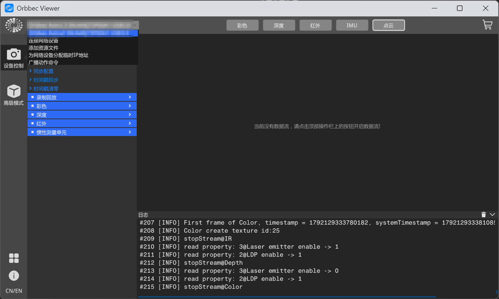

# 01 下载安装与准备（Windows）

> **位置**：奥比中光深度相机通用上手 WIKI · Windows 平台
>
> **前置**：[通用 / 01 产品准备](../通用/01_产品准备.md)
>
> **相关**：[02 SDK 示例上手](02_SDK示例上手.md)
>
> **本步目标**：安装 OrbbecViewer 与 SDK → 完成 Windows 元数据注册 → 能枚举到设备

## 0. 结论

> ✅ 从 [Releases 页](https://github.com/orbbec/OrbbecSDK_v2/releases) 下载 **`OrbbecSDK_<版本>_win64.exe`**，即当前最新版本的一体安装包。

该安装包同时包含 **OrbbecViewer** 与 **Orbbec SDK v2**，安装一次即可满足两种用途：

| 用途          | 使用工具                            | 本文步骤                                             |
| ----------- | ------------------------------- | ------------------------------------------------ |
| 查看图像、验证设备状态 | **OrbbecViewer**（图形界面）          | 第 3 节安装 → 第 4 节                                  |
| 编写程序读取数据流   | **Orbbec SDK v2**（C/C++/Python） | 第 3 节安装 → 第 4 节验证 → [02 SDK 示例上手](02_SDK示例上手.md) |

> 第 5 节（元数据注册）两种用途均需执行。

## 1. 系统要求

| 项目   | 要求                                                                              |
| ---- | ------------------------------------------------------------------------------- |
| 操作系统 | Windows 10 及以上（x64）。官方 OrbbecViewer 文档给出的最低版本为 **Windows 10 1803（build 17134）** |
| 接口   | USB 3.0 口（推荐；USB 2.0 可运行，但高分辨率 / 高帧率受限）                                         |
| 硬件   | 内存 8GB 及以上；建议四核 2.9GHz 及以上                                                      |

> 编译 SDK 示例需另行安装 Visual Studio 与 CMake，见 [02 SDK 示例上手](02_SDK示例上手.md) 第 2 节。

## 2. 下载

### 2.1 确认设备支持的 SDK 版本

不同型号支持的 SDK 世代不同，需先确认应下载 v1 还是 v2。

1. **确认设备型号** —— 查看设备机身丝印上的型号与料号，或参考包装、规格书。
2. **查询支持列表** —— 在 [Orbbec SDK v2 README](https://github.com/orbbec/OrbbecSDK_v2) 的「型号 × v1 / v2 支持状态」表中查找对应型号，查看 **Orbbec SDK v2** 一列。
3. **按判定结果选择下载位置**：

| v2 列中的判定                                           | 下载位置                                                                                                                                 |
| -------------------------------------------------- | ------------------------------------------------------------------------------------------------------------------------------------ |
| `recommended for new designs` / `full maintenance` | ✅ [Orbbec SDK v2 Releases](https://github.com/orbbec/OrbbecSDK_v2/releases) —— 继续阅读本文                                                |
| `limited maintenance` / `not supported`            | ⚠️ [Orbbec SDK v1 仓库](https://github.com/orbbec/OrbbecSDK)（国内可访问镜像：[Gitee](https://gitee.com/orbbecdeveloper/OrbbecSDK)）—— **本文不适用** |
| 列表中没有该型号                                           | 在 [官方文档中心](https://doc.orbbec.com/) 按型号查询，或联系厂商技术支持                                                                                  |

> ⚠️ 已知在 v2 列为 `not supported` 的型号：`Astra+`、`Astra Pro Plus`、`Gemini 2 XL`，这些型号只能使用 SDK v1。
>
> `Astra Mini Pro` / `Astra Mini S Pro` 为**双协议型号**，需按设备实际固件判断：固件主版本为 `v2.x.x`（UVC 协议）时使用 SDK v2；为 `v1.x.x`（OpenNI 协议）时使用 SDK v1。详见 [通用 / 01 产品准备](../通用/01_产品准备.md) 第 6 节。
>
> 其他参考资料（规格书、文档中心、中文下载中心）见 [通用 / 01 产品准备 · 附 B 资料入口](../通用/01_产品准备.md)。

### 2.2 选择下载文件

Releases 页的 Assets 中同时提供多类安装包，其类型与设备型号无关，只需按下表识别，以避免下载错误。Windows 平台会出现以下三类包：

| #     | 文件名                                           | 说明               | 安装后可用的内容                          |
| ----- | --------------------------------------------- | ---------------- | --------------------------------- |
| **①** | `OrbbecSDK_<版本>_win64.exe`                    | **一体安装包**，运行安装向导 | OrbbecViewer 与 SDK 全套             |
| ②     | `OrbbecSDK_<版本>_<日期>_<commit>_win_x64.zip`    | SDK 压缩包，解压即用     | 库 / 头文件 / 示例 / `scripts`，使用前需自行编译 |
| ③     | `OrbbecViewer_<版本>_<日期>_<commit>_win_x64.zip` | 独立查看器，解压即用、免安装   | 仅查看器，**不含 SDK**                   |

✅ **本步骤使用 ①**。

> 下载前需先点击 Assets 区域的 `Show all xx assets` 展开全部文件，避免遗漏。
>
> 文件识别方式：**前缀**（`OrbbecSDK` / `OrbbecViewer`）加**平台后缀**（`win64.exe` / `win_x64.zip`）。文件名中的版本号、日期与 commit 号随版本变化，不影响识别；`linux_*`、`macOS`、`.deb`、`.tar.gz` 等为非 Windows 平台文件，可忽略。

## 3. 安装

运行 `OrbbecSDK_<版本>_win64.exe`，按安装向导完成安装。**请记录安装目录**，后续步骤需引用，本文以 `<安装目录>` 表示。

安装完成后，目录结构如下：

| 路径                                           | 内容                     | 用途                |
| -------------------------------------------- | ---------------------- | ----------------- |
| `tools\OrbbecViewer.exe`                     | 图形界面程序                 | 查看图像（第 4 节）       |
| `shared\obsensor_metadata_win10.ps1`         | 元数据注册脚本（同目录附 `.md` 说明） | **必须执行**，见第 5 节   |
| `include\libobsensor\` · `lib\OrbbecSDK.lib` | 头文件与导入库                | 编译程序时使用（见 02）     |
| `bin\OrbbecSDK.dll`（及 `bin\extensions\`）     | 运行时动态库                 | 运行示例程序时使用（见 02）   |
| `examples\src\`                              | 官方示例源码                 | 学习 API、跑通取流（见 02） |
| `build_examples.ps1`                         | 一键编译示例的脚本              | 见 02              |
| `tools\USBDownloadTool.exe`                  | 设备与固件工具                | 固件升级时使用           |

> ⚠️ 安装包的目录结构与 GitHub 源码仓库不同：**安装包内没有 `scripts` 目录**，元数据注册脚本位于 `shared\`、查看器位于 `tools\`，而非源码仓库中的 `scripts\env_setup\`。
>
> 可将 `tools\OrbbecViewer.exe` 创建为桌面快捷方式，便于后续使用。

### 驱动说明

Orbbec SDK v2 使用 **UVC 协议**，通常**无需安装额外驱动**，连接设备后即可被系统识别。

需要安装 Windows 驱动的是 OpenNI 协议（v1 体系）机型：`DaBai` / `DaBai DCW` / `DaBai DW` / `Astra Mini Pro` / `Astra Pro Plus` / `A1 Pro` / `Gemini E` / `Gemini E Lite` / `Gemini`。

若设备型号不在上述名单中，且使用 SDK v2，则无需安装驱动 —— `astra-win32-driver-*.zip` 一类驱动对其无效。

## 4. 查看图像：使用 OrbbecViewer

1. 运行 **OrbbecViewer**：`<安装目录>\tools\OrbbecViewer.exe`。
2. 左侧「设备控制」列表应显示已连接的设备，表示主机已识别到设备。列表项包含**型号、序列号与接口类型**（形如 `Orbbec Astra 2 <序列号> USB3.0`），可用于确认连接速率是否为 USB 3.0。
3. 点击**顶部工具栏**的 **彩色 / 深度 / 红外 / IMU / 点云** 按钮，开启对应的数据流。



> 界面构成：左侧为设备列表，顶部为数据流按钮（与左侧「高级模式」下的条目一一对应），底部为日志区。
>
> ⚠️ 首次打开时画面为黑色，并提示「当前没有数据流，请点击顶部操作栏上的按钮开启数据流!」，**属正常现象**，点击顶部对应按钮后即可显示图像。

也可通过「设备管理器」确认：`Win + R` → `devmgmt.msc` → 「摄像头」分类下应能看到该设备。

> 官方图文指引：[相机简易使用指南](https://www.orbbec.com.cn/index/Gemini330/info.html?cate=119\&id=79)（含启动 Viewer 与「断开重连」的处理办法）· [OrbbecViewer 功能与支持平台](https://orbbec.github.io/OrbbecSDK_v2/docs/tutorial/orbbecviewer.html)

## 5. 元数据注册（Windows 必须执行）

**原因**：Windows 默认限制 UVC 相机的元数据（metadata）获取。未注册会导致设备时间戳异常，进而影响 SDK 内部帧同步（多流时间戳不对齐、帧同步失效）。参见官方说明 [obsensor\_metadata\_win10.md](https://github.com/orbbec/OrbbecSDK_v2/blob/main/scripts/env_setup/obsensor_metadata_win10.md)（已在 Windows 10 / 11 验证）。

**脚本位置**：`<安装目录>\shared\obsensor_metadata_win10.ps1`

1. 连接设备，确认设备在线。
2. 以**普通权限**打开 PowerShell（脚本会自动请求 UAC 提权），进入脚本所在目录，并按顺序执行以下命令：

```powershell
cd "<安装目录>\shared"
Set-ExecutionPolicy -ExecutionPolicy RemoteSigned -Scope CurrentUser   # 放开执行策略，仅需执行一次
.\obsensor_metadata_win10.ps1 -op install_all                          # 执行注册
```

执行后将弹出 UAC 提示，确认后脚本在**新窗口**中输出 `N connected Orbbec devices were found: …`，以及 `adding metadata key`（本次写入）或 `skipping - metadata key already exists`（已存在）。

> - **参数说明**：`install_all`（推荐，覆盖所有曾连接过的设备，后续更换设备通常无需重新执行）、`install`（默认，仅当前在线的设备）、`remove` / `remove_all`（移除已写入的键，需要回退时使用）。
> - **脚本行为**：在 `HKLM\SYSTEM\CurrentControlSet\Control\DeviceClasses\{…}\…\Device Parameters` 下，为奥比（`VID_2BC5`）UVC 设备写入 `MetadataBufferSizeInKB0 = 5`（多 pin 接口另加 `1`、`2` 两项），以放开元数据缓冲。
> - ⚠️ 官方说明：**每接入一台新设备均需重新执行一次**。建议将上述命令保存为脚本，便于复用。
> - 若安装目录中未包含该脚本（个别旧版安装包可能不含），可从 GitHub 获取：[脚本](https://github.com/orbbec/OrbbecSDK_v2/blob/main/scripts/env_setup/obsensor_metadata_win10.ps1) · [说明](https://github.com/orbbec/OrbbecSDK_v2/blob/main/scripts/env_setup/obsensor_metadata_win10.md)

**故障处理**

| 现象                | 处理                                                                                                                                                                               |
| ----------------- | -------------------------------------------------------------------------------------------------------------------------------------------------------------------------------- |
| 提示脚本被禁止运行         | 未放开执行策略，回到上述第 2 步第 1 条命令                                                                                                                                                         |
| 提示「未数字签名」仍被拒绝     | 仅**从浏览器下载**的脚本会出现此情况（安装目录中的脚本无此标记）。先执行 `Unblock-File .\obsensor_metadata_win10.ps1`，或改用 `powershell -ExecutionPolicy Bypass -File .\obsensor_metadata_win10.ps1 -op install_all` |
| 脚本执行后窗口立即关闭，看不到输出 | 脚本已提权并另开窗口，输出在**新窗口中**                                                                                                                                                           |
| 找不到脚本             | 脚本位于 `<安装目录>\shared\`，不是 `scripts\env_setup\`（后者为 GitHub 源码仓库的路径）                                                                                                                |
| 提示权限不足或无响应        | UAC 提权请求被拒绝                                                                                                                                                                      |
| 注册后时间戳仍异常         | 断开设备后重新连接，再次执行脚本                                                                                                                                                                 |

## 6. 后续步骤

本文到「安装完成、可查看图像、元数据注册完成」为止。SDK 部分见下一篇：

- 了解 `examples\` 中提供的示例，并编译运行第一个示例 → [02 SDK 示例上手](02_SDK示例上手.md)
- 使用 SDK 编写取流程序 → `03_SDK自写取流.md`（待写）
- 其他平台 → [Ubuntu · 01 下载安装与准备](../Ubuntu平台/01_下载安装与准备.md)

---

版本：v1.0（2026-10-16）
