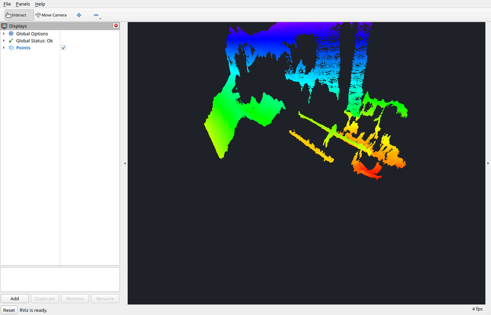
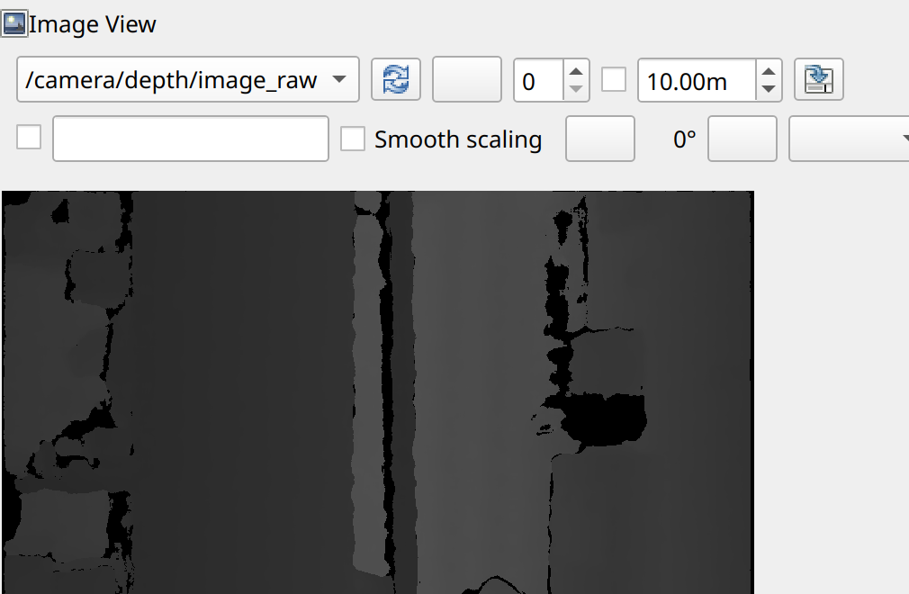

# 启动与查看数据流（Ubuntu）

> 位置：任务二 / Ubuntu平台
>
> 前置：已完成 [Ubuntu平台 / 01 环境准备与驱动安装](01_环境准备与驱动安装.md)，`list_devices_node` 能识别相机
>
> 相关：[通用 02 话题与坐标系](../通用/02_话题与坐标系.md) · [通用 03 机器人集成要点](../通用/03_机器人集成要点.md)
>
> 本步目标：启动相机节点，确认三路图像与点云正常输出，并在 RViz2 中查看
>
> 示例环境：示例设备 **Astra 2**，驱动 **OrbbecSDK ROS2 Wrapper v2.10.6**，**ROS 2 Jazzy**；下文的 `<ROS 发行版>` 即该版本的发行版代号

## 0. 结论

✅ 启动只需一条命令：`ros2 launch orbbec_camera astra2.launch.py`；型号与启动文件的对应关系见 [通用 01 第 3 节](../通用/01_接入方案与准备.md)。

✅ 查看数据用 RViz2：加 `Image` 显示订阅 `/camera/color/image_raw` 与 `/camera/depth/image_raw`，加 `PointCloud2` 显示订阅 `/camera/depth/points`。

## 1. 启动相机节点

```bash
source /opt/ros/<ROS 发行版>/setup.bash
ros2 launch orbbec_camera astra2.launch.py
```

启动过程约需两秒，日志中的关键行如下：

```text
[camera.camera]: Device Orbbec Astra 2 connected
[camera.camera]: Serial number: <序列号>
[camera.camera]: Firmware version: <固件版本>
[camera.camera]: ROS Wrapper version: <驱动版本>
[camera.camera]: SDK version: <SDK 版本>
[camera.camera]: usb connect type: USB3.0
[camera.camera]: depth Frame - Width: 800 Height: 600 fps: 30 Format: Y16
[camera.camera]: ir Frame - Width: 800 Height: 600 fps: 30 Format: Y8
[camera.camera]: color Frame - Width: 1280 Height: 720 fps: 30 Format: MJPG
[camera.camera]: Initialize device cost: <毫秒数> ms
```

三行 `Frame - Width …` 表示各路流已按该分辨率与格式启动。出现这三行即可进入下一步；若缺少某一路，检查启动参数中对应的 `enable_*` 与分辨率是否落在设备支持的组合内。

## 2. 确认数据流

新开一个终端（同样先 source），逐项确认：

```bash
ros2 topic list
ros2 topic hz /camera/depth/image_raw
ros2 topic hz /camera/color/image_raw
```

`ros2 topic hz` 会输出统计帧率；统计需要等待数帧，中途没有输出属正常。

查看节点自报的各流帧率、延迟与订阅者状态：

```bash
ros2 topic echo /camera/device_status --once
```

其中每路流的 `publish_rate_hz` 为该流最近的实际发布频率，`delay_ms_avg` 为平均延迟。设备在线状态由 `device_online` 给出。

## 3. 在 RViz2 中查看

```bash
rviz2
```

在 RViz2 中依次添加显示项：

| 显示类型 | 话题 | 看到的内容 |
|---|---|---|
| `Image` | `/camera/color/image_raw` | 彩色图像 |
| `Image` | `/camera/depth/image_raw` | 深度图（默认按原始 16 位显示，灰度随距离变化） |
| `PointCloud2` | `/camera/depth/points` | 由深度图生成的三维点云 |
| `Image` | `/camera/ir/image_raw` | 红外图像 |

`PointCloud2` 的 `Size (m)` 调小到 `0.01` 左右、`Style` 选 `Points` 更容易观察。



图为 `PointCloud2` 显示 `/camera/depth/points` 的效果：`Fixed Frame` 设为 `camera_depth_optical_frame`，`Color Transformer` 设为 `AxisColor`、`Axis` 设为 `Z`，颜色随深度变化（近处偏红、远处偏蓝）。画面左侧 `Displays` 中的 `Global Status: Ok` 表示 TF 与话题均正常。

⚠️ `Global Options → Fixed Frame` 必须与消息的 `frame_id` 属于同一棵 TF 树。只看相机数据时设为 `camera_depth_optical_frame` 即可；若设为 `base_link` 而尚未发布机体到相机的变换，RViz2 会提示 `No transform from ...`，此时按 [通用 03 第 1 节](../通用/03_机器人集成要点.md) 补静态变换。

轻量查看单路图像也可用 `rqt_image_view`（需先安装）：

```bash
sudo apt install ros-<ROS 发行版>-rqt-image-view
ros2 run rqt_image_view rqt_image_view /camera/depth/image_raw
```



图为 `rqt_image_view` 订阅 `/camera/depth/image_raw` 的效果：窗口顶部下拉框为当前话题，深色区域为有效深度（灰度随距离变化），黑色为无效值。深度图以原始 16 位灰度显示，不做伪彩色映射。

## 4. 常用启动参数

参数在启动命令后以 `名称:=值` 形式覆盖，可叠加多个。示例环境（Astra 2）的默认值如下：

| 参数 | 默认值 | 说明 |
|---|---|---|
| `camera_name` | `camera` | 话题命名空间 |
| `serial_number` | 空 | 多相机时指定设备 |
| `enable_depth` / `enable_color` / `enable_ir` | `true` | 各路流开关 |
| `depth_width` / `depth_height` / `depth_fps` | `800` / `600` / `30` | 深度流参数 |
| `color_width` / `color_height` / `color_fps` | `1280` / `720` / `30` | 彩色流参数 |
| `color_format` | `MJPG` | 彩色采集格式 |
| `ir_width` / `ir_height` / `ir_fps` | `800` / `600` / `30` | 红外流参数 |
| `enable_point_cloud` | `true` | 是否生成点云 |
| `enable_colored_point_cloud` | `false` | 是否生成彩色点云 |
| `depth_registration` | `false` | 深度是否注册到彩色帧 |
| `publish_tf` | `true` | 是否发布相机内部 TF |
| `color_frame_queue_max_frames` | `1` | 彩色帧队列长度 |
| `uvc_backend` | `libuvc` | 采集后端 |
| `time_domain` | `global` | 时间戳基准 |

只保留深度流并降低分辨率：

```bash
ros2 launch orbbec_camera astra2.launch.py \
  enable_color:=false enable_ir:=false \
  depth_width:=400 depth_height:=300 depth_fps:=15
```

为相机改名（多相机场景）：

```bash
ros2 launch orbbec_camera astra2.launch.py camera_name:=camera_front
```

参数完整的取值与含义可用以下命令查看：

```bash
ros2 launch orbbec_camera astra2.launch.py --show-args
```

### 深度滤波

深度图常出现空洞（黑色区域）、边缘飞点或帧间抖动，由深度后处理滤波器处理。启动文件已为各滤波器定义了参数，默认多数关闭，仅噪声去除默认开启。

| 参数 | 默认值 | 作用 |
|---|---|---|
| `enable_noise_removal_filter` | `true` | 去除离散噪声点；`noise_removal_filter_min_diff` 与 `noise_removal_filter_max_size` 控制判定阈值与邻域范围 |
| `enable_spatial_filter` | `false` | 空间滤波，平滑单帧图像，减少边缘飞点；参数 `spatial_filter_alpha` `spatial_filter_diff_threshold` `spatial_filter_magnitude` `spatial_filter_radius` |
| `enable_temporal_filter` | `false` | 时域滤波，抑制帧间抖动；参数 `temporal_filter_diff_threshold` `temporal_filter_weight` |
| `enable_hole_filling_filter` | `false` | 填补深度空洞；参数 `hole_filling_filter_mode` |
| `enable_threshold_filter` | `false` | 按距离阈值裁剪；参数 `threshold_filter_min` / `threshold_filter_max` |
| `enable_decimation_filter` | `false` | 降采样，降低数据量；参数 `decimation_filter_scale` |

示例：为近距离抓取场景打开时域滤波与空洞填补：

```bash
ros2 launch orbbec_camera astra2.launch.py \
  enable_temporal_filter:=true enable_hole_filling_filter:=true
```

⚠️ 滤波器在深度流上逐帧运算，全部开启会增加主机负载；参数取 `-1` 或空值时表示沿用设备当前值，而非关闭滤波器。各滤波器的完整参数与算法说明见[驱动文档](https://orbbec.github.io/OrbbecSDK_ROS2/)的深度过滤器章节。

## 5. 停止与重启

在启动节点的终端按 `Ctrl+C` 正常退出。节点会释放设备，之后可立即重新启动。

⚠️ 若进程被强制结束（`kill -9`、终端异常关闭），UVC 设备可能处于残留状态，再次启动时话题存在但**始终收不到数据**。此时重新插拔相机（或对 USB 端口执行复位）后再启动即可恢复。

## 6. 故障处理

| 现象 | 原因与处理 |
|---|---|
| 启动报找不到设备 / 设备数为 0 | 相机未接在 USB 3.0 端口、线材不支持 USB 3.0，或 udev 规则未生效；先 `lsusb` 确认设备存在 |
| 启动报参数不支持 / profile 无效 | 分辨率、帧率或格式不在设备支持列表内；用 `ros2 run orbbec_camera list_camera_profile_mode_node` 查询 |
| 话题存在但收不到数据 | 上次进程异常退出导致设备残留；按第 5 节重新插拔后重启 |
| 启动瞬间出现 `Color frame queue overflow` | 首帧到达速度超过队列长度（默认 1 帧），属启动瞬态；持续出现时降低分辨率或帧率 |
| RViz2 报 `No transform` | Fixed Frame 与消息坐标系不在同一 TF 树；改 Fixed Frame 或补机体到相机的静态变换 |
| RViz2 中点云不显示 | 未开启 `enable_point_cloud`，或 `Size (m)` 过大；同时确认 Fixed Frame 正确 |
| CPU 占用过高 | 关闭不用的流、降低分辨率或帧率、关闭点云输出（见 [通用 03 第 3 节](../通用/03_机器人集成要点.md)） |
| 深度图大面积空白 | 场景超出量程、表面反光或过暗；`0` 为无效值属正常现象 |

## 7. 后续步骤

1. [通用 02 话题与坐标系](../通用/02_话题与坐标系.md) —— 在自研节点中订阅数据
2. [通用 03 机器人集成要点](../通用/03_机器人集成要点.md) —— 接入机体坐标系、外参与资源规划
3. [Ubuntu平台 / 01 环境准备与驱动安装](01_环境准备与驱动安装.md) —— 回顾安装与权限配置